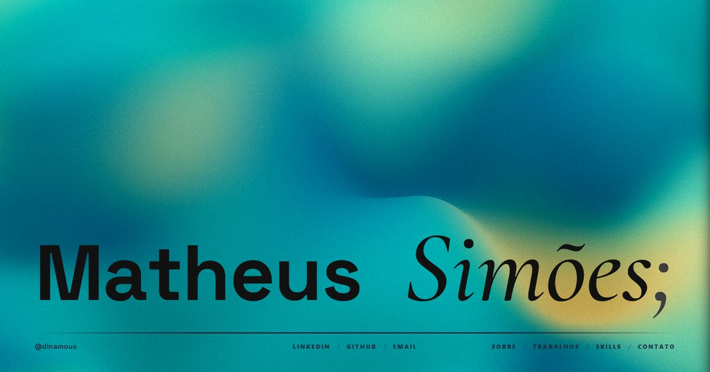
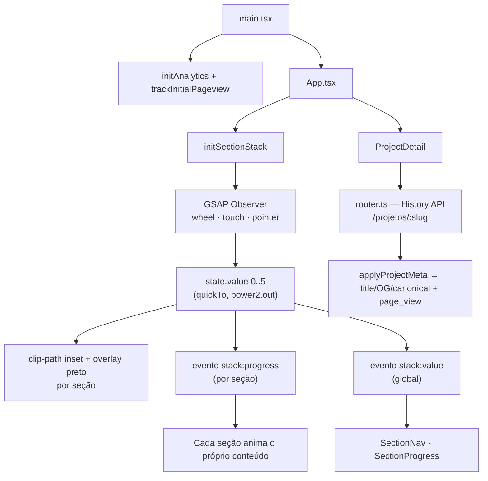

<div align="center">

# 💻 Portfólio — Dinamous

**Portfólio pessoal de [Matheus Simões](https://github.com/dinamous) — desenvolvedor frontend especializado em interfaces com motion design.**

Uma single-page application sem scroll nativo: as seções são camadas fixas empilhadas que se fecham
umas sobre as outras conforme o input de scroll avança, orquestradas inteiramente por GSAP.

[](https://vite.dev)
[](https://react.dev)
[](https://www.typescriptlang.org)
[](https://gsap.com)
[](https://tailwindcss.com)
[](https://dinamousdev.com.br)

### [🔗 Acessar o site → dinamousdev.com.br](https://dinamousdev.com.br)



</div>

---

## 📑 Sumário

- [Sobre o projeto](#-sobre-o-projeto)
- [Stack](#-stack)
- [Começando](#-começando)
- [Scripts](#-scripts)
- [Variáveis de ambiente](#-variáveis-de-ambiente)
- [Arquitetura](#-arquitetura)
  - [Section stack: o scroll da página](#section-stack-o-scroll-da-página)
  - [Roteamento de projetos](#roteamento-de-projetos)
  - [SEO: páginas estáticas geradas no build](#seo-páginas-estáticas-geradas-no-build)
  - [Pipeline de mídia](#pipeline-de-mídia)
  - [Analytics](#analytics)
- [Estrutura de pastas](#-estrutura-de-pastas)
- [Conteúdo: adicionando um projeto](#-conteúdo-adicionando-um-projeto)
- [Convenções de código](#-convenções-de-código)
- [Acessibilidade e performance](#-acessibilidade-e-performance)
- [Deploy](#-deploy)
- [Roadmap](#-roadmap)
- [Autor](#-autor)

---

## 🎯 Sobre o projeto

O site é uma vitrine técnica além de um portfólio: cada decisão de arquitetura existe para servir a
uma experiência de navegação contínua, sem recarregamento e sem barra de scroll.

**Seis seções**, todas `position: fixed` ocupando a viewport inteira, empilhadas por `z-index`:

| # | Seção | Id | O que apresenta |
|---|-------|-----|-----------------|
| 00 | **Hero** | `hero-section` | Abertura com loader, texto datilografado e fundo WebGL animado |
| 01 | **What I Do** | `whatido-section` | Áreas de atuação e o tipo de trabalho entregue |
| 02 | **Sobre** | `aboutme-section` | Apresentação pessoal em formato de ticket/passaporte |
| 03 | **Projetos** | `projects-section` | Galeria filtrável por categoria, com detalhe em rota própria |
| 04 | **Skills** | `skills-section` | Stack e ferramentas, com efeito `ScrambleText` |
| 05 | **Contato** | `contact-section` | Formulário que abre o WhatsApp, e-mail e redes |

**Destaques técnicos:**

- 🎬 **Motion-first** — 100% da animação (entrada, scroll, interação, transição) é GSAP. Zero `@keyframes` de interação, zero Framer Motion.
- 🧱 **Scroll próprio** — `Observer` do GSAP intercepta wheel/touch/pointer e converte em progresso de pilha; o navegador nunca rola.
- 🎨 **WebGL sem peso** — gradiente animado (`@firecms/neat`) na Hero e shader de scanner (`ogl`) escritos em GLSL puro.
- 🔗 **Rotas compartilháveis sem router** — `/projetos/:slug` via History API nativa, sem `react-router`.
- 🕷️ **SEO real numa SPA** — plugin de build gera um `.html` por projeto com `<head>` próprio + `sitemap.xml`.
- 📉 **Mídia otimizada por script** — WebP + VP9 + capas OG 1200×630 geradas com `sharp` e `ffmpeg`.
- ♿ **`prefers-reduced-motion` em toda animação** — sem exceção: estado final aplicado via `gsap.set()`.

---

## 🧰 Stack

### Runtime

| Pacote | Versão | Papel |
|--------|--------|-------|
| [`react`](https://react.dev) / `react-dom` | `^19.2` | UI. Sem `StrictMode` — ver [Convenções](#-convenções-de-código) |
| [`gsap`](https://gsap.com) | `^3.15` | **Toda** animação: timelines, `Observer`, `ScrambleTextPlugin`, `quickTo` |
| [`ogl`](https://github.com/oframe/ogl) | `^1.0` | WebGL mínimo para o shader de scanner |
| [`@firecms/neat`](https://neat.firecms.co) | `^1.0` | Gradiente animado em WebGL da Hero |
| [`parallax-js`](https://matthew.wagerfield.com/parallax/) | `^3.1` | Profundidade por `data-depth` nos cards |

### Build & Dev

| Pacote | Versão | Papel |
|--------|--------|-------|
| [`vite`](https://vite.dev) | `^7.0` | Bundler + dev server (+ plugin de SEO customizado) |
| [`typescript`](https://www.typescriptlang.org) | `^6.0` | Type-check no build (`tsc && vite build`) |
| [`tailwindcss`](https://tailwindcss.com) + `@tailwindcss/vite` | `^4.3` | Layout, spacing e cores estáticas |
| [`sharp`](https://sharp.pixelplumbing.com) | `^0.35` | Conversão WebP e geração das capas OG |
| [`eslint`](https://eslint.org) + `typescript-eslint` | `^10` / `^8` | Lint, com `react-hooks` e `react-refresh` |
| [`@playwright/test`](https://playwright.dev) | `^1.62` | Inspeção visual em desenvolvimento |
| `@fontsource/*` | `^5.3` | Space Grotesk (sans) e Cormorant Infant (serif) self-hosted |

> **Requisitos externos:** `ffmpeg` e `ffprobe` no `PATH` — usados apenas por `npm run media`.

---

## 🚀 Começando

### Pré-requisitos

```bash
node --version   # 22.x  (ver .nvmrc)
```

### Instalação

```bash
# 1. clone
git clone https://github.com/dinamous/portifolio-dinamous.git
cd portifolio-dinamous

# 2. use a versão de Node do projeto
nvm use            # lê o .nvmrc → 22

# 3. instale
npm install

# 4. suba o dev server
npm run dev        # http://localhost:5173
```

### Build de produção

```bash
npm run build      # tsc (type-check) → vite build → páginas SEO + sitemap
npm run preview    # serve o dist/ localmente
```

---

## 📜 Scripts

| Comando | O que faz |
|---------|-----------|
| `npm run dev` | Dev server do Vite com HMR |
| `npm run build` | Type-check (`tsc`) e build de produção; o plugin de SEO escreve `dist/projetos/*.html` e `dist/sitemap.xml` |
| `npm run preview` | Serve o `dist/` para validar o build final |
| `npm run lint` | ESLint em todo o projeto |
| `npm run media` | Otimiza a mídia dos projetos **in-place** e gera as capas OG — ver [Pipeline de mídia](#pipeline-de-mídia) |

---

## 🔐 Variáveis de ambiente

Variáveis client-side usam o prefixo `VITE_` (tipadas explicitamente em [`src/env.d.ts`](src/env.d.ts)).

```bash
# .env.local
VITE_GA_ID=G-XXXXXXXXXX
```

| Variável | Obrigatória | Descrição |
|----------|-------------|-----------|
| `VITE_GA_ID` | Não | ID de medição do GA4. **Sem ela, o analytics vira no-op completo** — nenhum request é feito e visitas de desenvolvimento não sujam o relatório. |

---

## 🏗 Arquitetura



### Section stack: o scroll da página

Todo o comportamento vive em **[`src/lib/sectionStack.ts`](src/lib/sectionStack.ts)** — é o coração do site.

**Como funciona:**

1. Toda seção marcada com `data-stack` é registrada e recebe `z-index` **decrescente** — as primeiras ficam por cima, cobrindo as seguintes até se fecharem.
2. Um `Observer` do GSAP captura `wheel`, `touch` e `pointer` com `preventDefault: true`. O scroll nativo do navegador nunca acontece.
3. O delta acumula num `target` normalizado (`0 .. nº de seções - 1`) e é aplicado a `state.value` por um **`gsap.quickTo`** — retargetar o mesmo tween em vez de criar um novo por evento é o que transforma notches discretos de wheel em movimento contínuo.
4. A cada tick, cada seção recebe `clip-path: inset(...)` fechando das laterais até virar uma barra de `5vw`, com um overlay preto subindo por cima.

**Detalhes que importam:**

| Constante | Valor | Por quê |
|-----------|-------|---------|
| `HOLD` | `0.25` | Fatia inicial do range em que o scroll não move nada — dá um respiro depois da entrada da seção |
| `TRANSITION_DISTANCE` | `1800px` | Curso de wheel/touch para fechar uma seção; alto o bastante para cada notch ler como glide, não como salto |
| `TOUCH_SENSITIVITY` | `3.2` | Um swipe cobre muito menos px que a soma de notches de wheel — sem o boost, seria preciso vários swipes por seção |
| `CLIP_CLOSE_T` | `0.7` | O clip termina antes de `local === 1`, deixando o range restante livre para o "finale" próprio da seção |

**Contratos públicos:**

```ts
initSectionStack()          // registra as seções e liga o Observer (singleton)
enableSectionStack()        // libera o input — só depois do intro da Hero terminar
goToSection("projects-section")  // navegação por clique, com duration escalando pela distância
lockSectionStack()          // Observer.disable() — usado pelo overlay de projeto
unlockSectionStack()
refreshSectionStack()       // re-emite o estado atual para quem acabou de remontar
```

**Eventos emitidos:**

- `stack:progress` (na seção) — `{ progress: 0..1 }` do fechamento dela. Cada seção reage ao próprio progresso sem que o módulo genérico toque em DOM específico.
- `stack:value` (no `window`) — posição global da pilha. Consumido por `SectionNav` e `SectionProgress`.

> **Escapes:** `data-no-close-clip` opta por sair do wipe genérico (a Skills usa cortina própria);
> `data-stack-scroll` marca uma coluna rolável interna, que recebe o delta primeiro e só devolve o
> controle à pilha ao bater na própria borda.

### Roteamento de projetos

[`src/lib/router.ts`](src/lib/router.ts) — **sem `react-router`**, apenas History API nativa, porque existe exatamente uma rota.

- `/projetos/:slug` abre o overlay `ProjectDetail`, é compartilhável e recarregável.
- `applyProjectMeta()` troca `document.title`, `description`, tags OG/Twitter e `canonical` na navegação client-side — é isso que faz a URL valer como página própria para o Googlebot, que indexa o DOM renderizado.
- Slug inválido é apagado da URL e cai na home, mas o `href` quebrado ainda aparece no relatório do GA — o que denuncia link morto circulando.

### SEO: páginas estáticas geradas no build

O plugin `seoPlugin()` em [`vite.config.ts`](vite.config.ts) roda no `closeBundle`:

| Saída | Conteúdo |
|-------|----------|
| `dist/projetos/<slug>.html` | Mesmo bundle e mesmo `#root`, apenas o `<head>` muda: `title`, `description`, `canonical` e OG/Twitter do projeto |
| `dist/sitemap.xml` | Home + todas as rotas de projeto |

> **O problema que isso resolve:** crawlers sem JS (LinkedIn, WhatsApp, Slack, Bing) só leem o HTML
> servido. Como o app é 100% client-side, **todo link de projeto compartilhado mostrava o card
> genérico da home** antes disso.

### Pipeline de mídia

[`scripts/optimize-media.mjs`](scripts/optimize-media.mjs) — **idempotente**, pula o que já está no formato/tamanho alvo.

```bash
npm run media
```

| Etapa | Transformação | Alvo |
|-------|---------------|------|
| **Imagens** | PNG/JPG → WebP `quality 80`, redimensionado | máx. `1600px` de largura |
| **Vídeos** | `.webm` → VP9 `crf 33` + Opus `64k` | máx. `720px` de altura |
| **Capas OG** | Primeira imagem de cada projeto → JPG `quality 82` | `1200×630` em `public/og/<slug>.jpg` |

> A capa da home vem de um print à parte (`src/assets/og/home.png`), recortado **pelo rodapé** — que
> é onde o nome fecha a Hero. De cima só sobraria gradiente.

### Analytics

[`src/lib/analytics.ts`](src/lib/analytics.ts) — **GA4 direto via `gtag.js`, sem container GTM**: existe só uma tag para carregar, e o container seria mais um request num site que já paga caro em WebGL + GSAP.

- `send_page_view: false` — numa SPA o automático só enxergaria o primeiro load, e ainda com o título estático do `index.html`.
- Todo `page_view` sai de `pageview()`, chamado por quem conhece o título canônico da rota.
- Guarda de `pathname` evita contagem dupla quando a mesma rota é reaplicada (ex.: `popstate`).

---

## 📁 Estrutura de pastas

```
portifolio-dinamous/
├── docs/superpowers/          # specs e planos de implementação por feature
│   ├── plans/
│   └── specs/
├── public/
│   ├── favicon/               # favicon completo + webmanifest
│   ├── og/                    # capas 1200x630 geradas por `npm run media`
│   ├── projects/              # imagens legadas (fallback do campo `img`)
│   ├── noise.png
│   └── robots.txt
├── scripts/
│   └── optimize-media.mjs     # WebP + VP9 + capas OG
├── src/
│   ├── assets/projects/<pasta>/   # mídia da galeria — auto-descoberta por import.meta.glob
│   ├── components/
│   │   ├── graphics/          # AccentRule, CropMarks, DashedLine, Perforation,
│   │   │                      # RegMark, Stamp, Ticks — vocabulário gráfico do site
│   │   ├── Navbar/
│   │   ├── ProjectGallery/
│   │   ├── SectionNav/
│   │   ├── SectionProgress/
│   │   ├── AnimatedLetters.tsx
│   │   ├── AnimatedWords.tsx
│   │   ├── HeroBackground.tsx     # gradiente WebGL (@firecms/neat)
│   │   └── ScannerBackground.tsx  # shader GLSL (ogl)
│   ├── lib/
│   │   ├── analytics.ts       # GA4
│   │   ├── contact.ts         # e-mail, WhatsApp, redes
│   │   ├── motion.ts          # prefersReducedMotion()
│   │   ├── projects.ts        # normalização + filtros + lookup por slug
│   │   ├── router.ts          # History API + meta tags por rota
│   │   ├── scrub.ts           # scrubValue / scrubTimeline com lag
│   │   ├── sectionStack.ts    # ⭐ o scroll da página
│   │   ├── slug.ts            # usado no runtime E no build (mesma URL nas duas pontas)
│   │   └── textType.ts        # efeito de digitação da Hero
│   ├── styles/global.css      # @import "tailwindcss" + tokens
│   ├── views/                 # uma pasta por seção: .tsx + .css companheiro
│   │   ├── Hero/  WhatIDo/  AboutMe/  Projects/  Skills/  Contact/
│   │   └── ProjectDetail/     # overlay da rota /projetos/:slug
│   ├── App.tsx
│   ├── env.d.ts
│   └── main.tsx
├── projects.json              # ⭐ fonte de conteúdo dos projetos
├── index.html                 # <head> canônico: OG, Twitter, JSON-LD (schema.org/Person)
├── vite.config.ts             # + seoPlugin()
├── vercel.json
└── CLAUDE.md                  # regras do projeto para agentes de IA
```

---

## 📦 Conteúdo: adicionando um projeto

**1.** Adicione a entrada em [`projects.json`](projects.json):

```jsonc
{
  "titulo": "Nome do Projeto",       // vira o slug: /projetos/nome-do-projeto
  "img": "/projects/fallback.webp",  // fallback quando não há `pasta`
  "pasta": "nome-da-pasta",          // src/assets/projects/<pasta>/
  "descricao": "Uma linha. Vira a meta description e o card de compartilhamento.",
  "techs": ["React", "GSAP"],
  "categoria": ["Front-End"],        // Front-End | Back-End | UI/UX | Mobile
  "actions": [{ "label": "Link", "link": "https://exemplo.com" }]
}
```

**2.** Solte a mídia em `src/assets/projects/<pasta>/`. **Nada mais precisa ser tocado** — o
`import.meta.glob` em [`src/lib/projects.ts`](src/lib/projects.ts) descobre todo `png|jpg|jpeg|webp|mp4|webm|mov` da pasta automaticamente.

> **Ordenação:** a galeria ordena pelo nome do arquivo original (a URL final do Vite leva hash, então
> não serve de critério). A thumb deve levar o prefixo `a0-` para vir primeiro.

**3.** Rode o otimizador:

```bash
npm run media
```

**Normalizações automáticas:**

- `categoria` tem grafia inconsistente no JSON (`Front-end` / `Front-End`) — [`projects.ts`](src/lib/projects.ts) normaliza para os rótulos do filtro.
- **`Fullstack` não existe no dado**: é derivado de o projeto ter Frontend *e* Backend.
- Filtros disponíveis: `Todos`, `Fullstack`, `Frontend`, `Backend`, `UI/UX`.

---

## ✍️ Convenções de código

> As regras completas vivem em [`CLAUDE.md`](CLAUDE.md) — o resumo:

### Animação

- ✅ **Toda** animação é GSAP. ❌ Sem `@keyframes`/`transition` para interação, sem Framer Motion, sem anime.js.
  - *Exceção documentada:* `@keyframes hero-type-blink` para o piscar do cursor — puramente decorativo.
- ✅ `gsap.registerPlugin()` **uma vez por plugin** no projeto inteiro.
- ✅ Sequenciamento de seções sempre via `sectionStack.ts` — nunca recriar a lógica.
- ✅ Uma timeline por seção/interação; encadear com position parameters (`"-="`, `"<"`, labels) — **nunca `setTimeout`**.
- ✅ Animar `transform`/`opacity`; nunca `width`/`top`/`left`.
- ✅ Checar `prefers-reduced-motion` e pular para o estado final via `gsap.set()`.

### React

- Dados/props no corpo do componente; DOM e GSAP em `useEffect`, buscando por id/seletor.
- **Todo `useEffect` de animação limpa listeners/tweens no `return`** — sem isso, remount/HMR duplica listeners.
- Um componente = um `.tsx` + um `.css` companheiro de mesmo nome, importado direto. Sem CSS Modules — as classes já são BEM.
- **Sem `StrictMode`** em [`main.tsx`](src/main.tsx): os efeitos são timelines imperativas de disparo único, portadas do Astro, não escritas para sobreviver a double-mount.

### CSS

- Tailwind 4 via `@import "tailwindcss"` para layout, spacing e cores estáticas.
- O `.css` do componente só para o que Tailwind não cobre bem: BEM custom com `clamp()`, alvos de animação GSAP.
- Nomenclatura BEM: `.hero__word--first`.

### Geral

- Comentários **só** quando explicam um "porquê" não óbvio. Os marcadores `ponytail:` sinalizam simplificações deliberadas, com o teto conhecido e o caminho de upgrade.
- Antes de escrever lógica nova, **checar `src/lib/`** — preferir estender a duplicar.
- Commits em [gitmoji](https://gitmoji.dev): `feat: :sparkles: ...`, `fix: :bug: ...`, `refactor: :recycle: ...`.

---

## ♿ Acessibilidade e performance

| Frente | Implementação |
|--------|---------------|
| **Reduced motion** | Checado em `sectionStack`, `HeroBackground`, `ScannerBackground`, `textType` e em cada seção. O `quickTo` é substituído por escrita direta — `duration: 0` divide por zero internamente e propagaria `NaN` para `state.value`, congelando a pilha inteira |
| **Semântica** | `<section>`/`<h1>`–`<h2>` reais, `aria-label` na navegação, `aria-hidden` no decorativo, `role="status"` no feedback do formulário |
| **Navegação** | Seções também acessíveis por clique (`SectionNav`), com a URL refletindo a posição via `replaceState` — cada clique **não** vira entrada no histórico |
| **Mídia** | WebP + VP9; imagens no máx. 1600px, vídeos no máx. 720px |
| **Cache** | `/assets/*` com `max-age=31536000, immutable` (nomes hasheados pelo Vite) |
| **Assets críticos** | Fontes self-hosted via `@fontsource` — sem request a CDN de terceiros |
| **Analytics** | GA4 direto, sem container GTM — um request a menos |

---

## 🚢 Deploy

Hospedado na **[Vercel](https://vercel.com)**, configurado por [`vercel.json`](vercel.json):

```jsonc
{
  "cleanUrls": true,
  "trailingSlash": false,
  "headers": [ /* cache imutável em /assets/* */ ],
  "rewrites": [{ "source": "/(.*)", "destination": "/index.html" }],
  "ignoreCommand": "git diff --quiet HEAD^ HEAD -- . ':!*.md' ':!docs'"
}
```

| Ajuste | Motivo |
|--------|--------|
| `rewrites` | SPA fallback: `/projetos/:slug` precisa servir o app em qualquer URL |
| `cleanUrls` | As páginas SEO são escritas como `dist/projetos/<slug>.html` e servidas sem a extensão |
| `ignoreCommand` | Commits que só tocam `*.md` ou `docs/` **não disparam build** |


---

## 👾 Autor

<table>
  <tr>
    <td align="center">
      <a href="https://github.com/dinamous">
        <br>
        <sub><b>Matheus Simões</b></sub>
      </a>
      <br><sub>Motion Frontend</sub>
    </td>
  </tr>
</table>

<div align="center">

[](https://www.linkedin.com/in/dinamous/)
[](https://github.com/dinamous)
[](https://www.instagram.com/dinamous.dev)
[](mailto:dinamous.dev@gmail.com)

📍 São Paulo, Brasil · ✅ Disponível para novos projetos · ⏱ Respondo em até 24h

</div>
